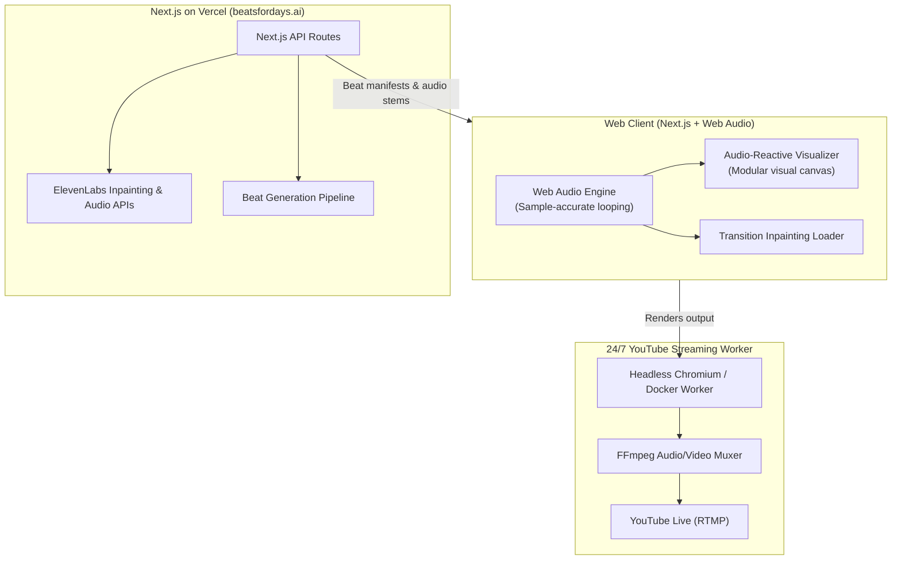

# Beats for Days 🎧

> **Infinite 90s Golden Era Boom Bap, Powered by Generative AI.**  
> Live at [beatsfordays.ai](https://beatsfordays.ai) · Hosted on [Vercel](https://vercel.com)

---

## 📻 Overview

**Beats for Days** is an infinite generative music experience dedicated to the golden era of 90s boom bap hip hop (dusty vinyl chops, punchy SP-1200 / MPC kicks & snares, warm basslines, and hypnotic grooves).

The platform continuously generates, loops, and evolves beats in real time:
- **In-Track Looping:** Handled natively in the client using the **Web Audio API** for sample-accurate, gapless playback.
- **Track Transitions & Bridging:** Custom **ElevenLabs audio inpainting** pipelines to smoothly morph and transition between distinct generated boom bap tracks.
- **Visual Presentation:** A highly visual, audio-reactive frontend designed to double as a full-screen ambient player and stream source.
- **24/7 YouTube Live Stream:** Broadcast continuously via an independent headless streaming worker feeding YouTube Live RTMP.

---

## 🏛️ System Architecture



---

## 🛠️ Tech Stack

- **Framework:** [Next.js](https://nextjs.org/) (App Router, TypeScript)
- **Styling:** [Tailwind CSS](https://tailwindcss.com/)
- **Audio Engine:** Web Audio API (client-side gapless looping, gain nodes, analyser nodes)
- **AI Audio Engine:** [ElevenLabs](https://elevenlabs.io/) (inpainting and generation API)
- **Hosting & Edge:** [Vercel](https://vercel.com/)
- **Visual Engine:** Modular visualizer architecture (visual style TBD)
- **Live Stream Pipeline:** Cloud worker (Docker / Headless Chromium + FFmpeg streaming to YouTube RTMP)

---

## 📂 Repository Structure (Planned)

```text
beats-for-days/
├── src/
│   ├── app/                 # Next.js App Router pages & API routes
│   │   ├── api/             # Generation & inpainting endpoints
│   │   ├── layout.tsx       # Root layout
│   │   └── page.tsx         # Main player & visualizer interface
│   ├── components/          # Reusable UI & visualizer components
│   │   ├── audio/           # Player controls, transport, volume
│   │   └── visualizer/      # Audio-reactive canvas / scene modules
│   ├── lib/
│   │   ├── audio/           # Web Audio API context, buffers, scheduling
│   │   ├── elevenlabs/      # API client & inpainting helpers
│   │   └── types/           # Shared TypeScript interfaces
│   └── styles/              # Global styles & Tailwind configuration
├── stream-worker/           # Headless browser + FFmpeg RTMP streaming worker
├── .gitignore
├── package.json
└── README.md
```

---

## 🚀 Getting Started

*(Next.js scaffolding and dependency setup will occur in the next milestone.)*

### Prerequisites
- Node.js 20+
- pnpm / npm / yarn
- ElevenLabs API credentials

---

## 🛣️ Roadmap

- [x] Initial design alignment & repository setup
- [ ] Scaffold Next.js (App Router, TypeScript, Tailwind CSS)
- [ ] Implement core Web Audio API loop engine (gapless bar looping)
- [ ] Integrate ElevenLabs inpainting pipeline for track transitions
- [ ] Build extensible visualizer component
- [ ] Deploy web player to Vercel (`beatsfordays.ai`)
- [ ] Configure headless streaming worker & launch 24/7 YouTube stream
