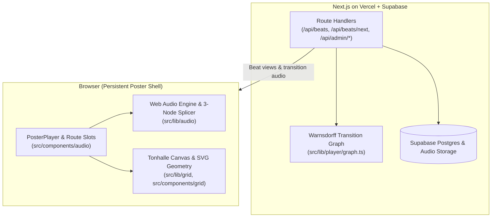

# Beats for Days 🎧

> **Infinite 90s Golden Era Boom Bap, Powered by Generative AI.**  
> Live at [beatsfordays.ai](https://beatsfordays.ai) · Hosted on [Vercel](https://vercel.com)

---

## 📻 Overview

**Beats for Days** is an infinite generative music experience dedicated to the golden era of 90s boom bap hip hop (dusty vinyl chops, punchy SP-1200 / MPC kicks & snares, warm basslines, and hypnotic grooves).

- **In-Track Looping:** Gapless, sample-accurate looping and 3-node transition splices in the browser via the **Web Audio API**, with turntable motor spin-up and brake physics.
- **Transition Graph:** Directed track graph traversed with 1-step Warnsdorff lookahead and a 20-track repeat cooldown so streams never trap in short loops.
- **Swiss Poster Player:** Full-screen Josef Müller-Brockmann (Tonhalle 1955) geometric canvas and SVG overlay, with GSAP morph transitions across `/`, `/beat/:slug`, `/about`, and `/privacy`.
- **24/7 YouTube Live Stream (planned):** Independent headless streaming worker feeding YouTube Live RTMP.

---

## 🏛️ System Architecture



---

## 🛠️ Tech Stack

- **Framework:** [Next.js 16](https://nextjs.org/) (App Router, TypeScript)
- **Styling:** Inlined semantic CSS Modules + OKLCH tokens on public routes; [Tailwind CSS v4](https://tailwindcss.com/) scoped to `/admin` ([ADR 0019](docs/decisions/0019-inline-semantic-css-and-isolate-admin-tailwind.md))
- **Audio Engine:** Web Audio API (sample-accurate looping, equal-power crossfades, LRU buffer cache, vinyl inertia)
- **Database & Storage:** [Supabase](https://supabase.com/) (Postgres catalog + `.m4a` audio bucket, with local static fallback in `public/audio/`)
- **Visual Engine:** Swiss geometric grid engine (`src/lib/grid/`) + HTML5 Canvas / SVG + GSAP transitions
- **Hosting:** [Vercel](https://vercel.com/)

---

## 📂 Repository Structure

```text
beats-for-days/
├── src/
│   ├── app/                 # Next.js App Router routes, layouts & API route handlers
│   ├── components/          # Thin, presentational React components (.tsx) & CSS Modules
│   │   ├── admin/           # Local-only catalog & transition audition dashboard (ADR 0016)
│   │   ├── audio/           # PosterPlayer, BeatNumber, TransportControls & audio context
│   │   ├── debug/           # Optional playback & history debug panel (?debug=1)
│   │   ├── grid/            # VinylVisualizer, SpectrumBars & GridOverlay canvases
│   │   └── layout/          # AppChrome route wrapper
│   └── lib/                 # Framework-agnostic logic (.ts): unit & mutation tested
│       ├── audio/           # Web Audio engine, scheduler, splice coordinator, cache, vinyl
│       ├── grid/            # Tonhalle poster geometry, angular cuts, GSAP interpolation
│       ├── player/          # Transition graph, Warnsdorff walk, URL & history sync
│       └── types/           # Shared beat and player state contracts
├── scripts/                 # Repo tooling: CRAP gate, DB/storage seeding, WAV->M4A converter
├── supabase/                # Local Supabase config & SQL schema migrations
├── test/                    # Shared Vitest setup & stubs
├── e2e/                     # Playwright + axe-core end-to-end browser tests
├── docs/                    # Architecture, decisions (ADRs) & guides
├── .agents/                 # Agent skills & hooks
└── AGENTS.md                # Instructions for AI coding agents
```

Full layout and layering rules: [`docs/architecture/overview.md`](docs/architecture/overview.md).

---

## 🚀 Getting Started

### Prerequisites

- Node.js 22.12+ (see `.nvmrc`)
- [pnpm](https://pnpm.io) (version pinned in `package.json`)
- [Docker Desktop](https://docs.docker.com/desktop/) or OrbStack (for local Supabase database and audio storage)
- [Supabase CLI](https://supabase.com/docs/guides/local-development/cli/getting-started) (`brew install supabase/tap/supabase`, v3 or newer)
- Optional: `brew install gitleaks` for local secret scanning

```bash
pnpm install                 # installs deps + git hooks
cp .env.example .env.local   # offline/mocked by default
supabase start               # start local Postgres + storage services
pnpm db:seed                 # seed tracks and transition graph
pnpm dev                     # http://localhost:3000
```

### Quality gate

```bash
pnpm check           # per task: typecheck · lint · a11y lint · tests for changed files
pnpm verify          # push gate: typecheck · lint · a11y lint · format · boundaries · knip · tests · CRAP
pnpm verify:full     # same as CI: verify · E2E + axe-core · Stryker mutation testing
```

See [`docs/guides/workflow.md`](docs/guides/workflow.md) and [`docs/guides/testing.md`](docs/guides/testing.md).

---

## 📚 Documentation

- [`docs/`](docs/README.md): architecture, guides
- [`docs/decisions/`](docs/decisions/README.md): Architecture Decision Records
- [`AGENTS.md`](AGENTS.md): conventions & definition of done for AI agents (and humans)

---

## 🛣️ Roadmap

- [x] Initial design alignment & repository setup
- [x] Scaffold Next.js (App Router, TypeScript) & quality foundation (CRAP gate, Stryker mutation testing, Playwright + axe-core CI)
- [x] Core Web Audio API loop engine (gapless looping, 3-node transition splices, turntable inertia)
- [x] Warnsdorff transition graph & bidirectional `/beat/:slug` URL synchronization
- [x] Swiss Tonhalle geometric poster visualizer with GSAP transitions
- [x] Local catalog & transition audition admin dashboard (`/admin`)
- [ ] On-the-fly ElevenLabs transition & beat generation pipeline (Phase 2)
- [ ] Headless streaming worker for 24/7 YouTube Live RTMP broadcast
