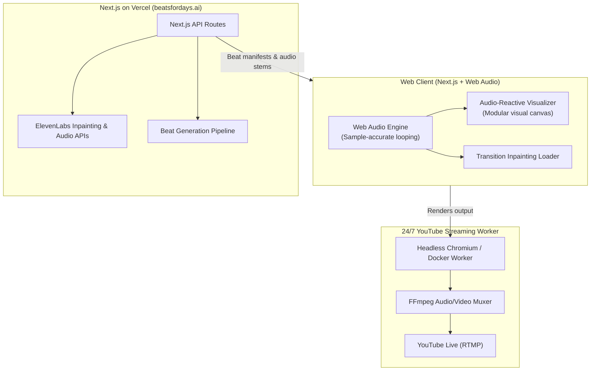

# Beats for Days 🎧

> **Infinite 90s Golden Era Boom Bap, Powered by Generative AI.**  
> Live at [beatsfordays.ai](https://beatsfordays.ai) · Hosted on [Vercel](https://vercel.com)

---

## 📻 Overview

**Beats for Days** is an infinite generative music experience dedicated to the golden era of 90s boom bap hip hop (dusty vinyl chops, punchy SP-1200 / MPC kicks & snares, warm basslines, and hypnotic grooves).

The platform continuously generates, loops, and evolves beats in real time:

- **In-Track Looping:** Handled natively in the client using the **Web Audio API** for sample-accurate, gapless playback.
- **Track Transitions & Bridging:** Custom **ElevenLabs audio inpainting** pipelines to smoothly morph and transition between distinct generated boom bap tracks.
- **Visual Presentation:** A highly visual, audio-reactive frontend designed to double as a full-screen ambient player and stream source.
- **24/7 YouTube Live Stream:** Broadcast continuously via an independent headless streaming worker feeding YouTube Live RTMP.

---

## 🏛️ System Architecture



---

## 🛠️ Tech Stack

- **Framework:** [Next.js](https://nextjs.org/) (App Router, TypeScript)
- **Styling:** [Tailwind CSS](https://tailwindcss.com/)
- **Audio Engine:** Web Audio API (client-side gapless looping, gain nodes, analyser nodes)
- **AI Audio Engine:** [ElevenLabs](https://elevenlabs.io/) (inpainting and generation API)
- **Hosting & Edge:** [Vercel](https://vercel.com/)
- **Visual Engine:** Modular visualizer architecture (visual style TBD)
- **Live Stream Pipeline:** Cloud worker (Docker / Headless Chromium + FFmpeg streaming to YouTube RTMP)

---

## 📂 Repository Structure

```text
beats-for-days/
├── src/
│   ├── app/                 # Next.js App Router routes, layouts & API route handlers
│   ├── components/          # Thin, presentational React components (.tsx)
│   └── lib/                 # Framework-agnostic logic (.ts): audio, visualizer, elevenlabs, env
├── scripts/crap/            # In-repo CRAP (complexity × coverage) gate
├── test/                    # Shared test setup & stubs
├── docs/                    # Architecture, decisions (ADRs) & guides
├── .agents/                 # Agent skills & hooks (Antigravity)
├── AGENTS.md                # Instructions for AI coding agents
└── stream-worker/           # (planned) Headless browser + FFmpeg RTMP worker
```

Full layout and layering rules: [`docs/architecture/overview.md`](docs/architecture/overview.md).

---

## 🚀 Getting Started

### Prerequisites

- Node.js 22.12+ (see `.nvmrc`)
- [pnpm](https://pnpm.io) (version pinned in `package.json`)
- [Docker Desktop](https://docs.docker.com/desktop/) or OrbStack (for local Supabase database and audio storage)
- [Supabase CLI](https://supabase.com/docs/guides/local-development/cli/getting-started) (`brew install supabase/tap/supabase`)
- Optional: ElevenLabs API credentials (only required when `ALLOW_LIVE_AI_CALLS=true`)
- Optional: `brew install gitleaks` for local secret scanning

```bash
pnpm install                 # installs deps + git hooks
cp .env.example .env.local   # offline/mocked by default; add ELEVENLABS_API_KEY only for live calls
supabase start               # start local postgres + storage services
pnpm exec tsx scripts/seed/cli.ts # seed tracks and seamless transitions
pnpm dev                     # http://localhost:3000
```

### Quality gate

```bash
pnpm verify          # typecheck · lint · format · boundaries · knip · tests · CRAP
pnpm test:mutation   # Stryker mutation testing (incremental)
```

See [`docs/guides/workflow.md`](docs/guides/workflow.md) and [`docs/guides/testing.md`](docs/guides/testing.md).

---

## 📚 Documentation

- [`docs/`](docs/README.md): architecture, guides
- [`docs/decisions/`](docs/decisions/README.md): Architecture Decision Records
- [`AGENTS.md`](AGENTS.md): conventions & definition of done for AI agents (and humans)

---

## 🛣️ Roadmap

- [x] Initial design alignment & repository setup
- [x] Scaffold Next.js (App Router, TypeScript, Tailwind CSS)
- [x] Quality foundation: docs/ADRs, CRAP gate, mutation testing, CI, agent guidelines
- [ ] Implement core Web Audio API loop engine (gapless bar looping)
- [ ] Integrate ElevenLabs inpainting pipeline for track transitions
- [ ] Build extensible visualizer component
- [ ] Deploy web player to Vercel (`beatsfordays.ai`)
- [ ] Configure headless streaming worker & launch 24/7 YouTube stream
