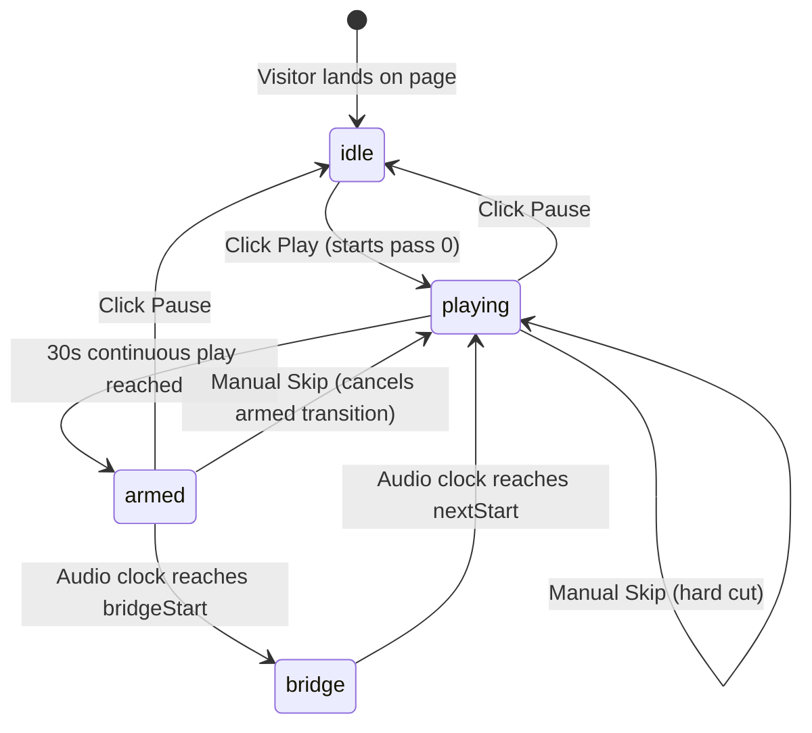

# Web Audio Engine Architecture

This document describes how Beats for Days loops tracks gaplessly and splices transitions using the Web Audio API.

## Core concepts

- **Loop anatomy:** Every beat has an intro, a loop section (verse, chorus, bridge), and an outro.
- **Sample-accurate looping:** The browser loops from `loopEndMs` back to `loopStartMs` using native `AudioBufferSourceNode` loop points.
- **Configurable continuous play:** After continuous playback reaches a threshold (`AUTO_TRANSITION_RESOLVE_SECONDS`, default 30s), the player arms the next transition.
- **Minimum pass requirement (`minPass = 1`):** A track must complete pass 0 and wrap through the loop at least once before transitioning.
- **3-node transition splice:** The engine crossfades track A into a transition bridge, and then crossfades the bridge into track B.

## Playback state machine

The player advances through four phases:

| Phase     | Description                                                                                            |
| --------- | ------------------------------------------------------------------------------------------------------ |
| `idle`    | Playback is stopped. The initial track is pre-resolved in the background.                              |
| `playing` | Audio is playing and looping gaplessly.                                                                |
| `armed`   | 30 seconds of continuous play reached. Next beat and transition buffers are pre-decoded and scheduled. |
| `bridge`  | Audio clock reaches transition start. Crossfade into the bridge node begins.                           |

## Track loop anatomy

Native Web Audio handles single-track looping without gap or click:

1. **Pass 0:** Starts at `0s` (Intro) or `landMs` (if arriving from a transition).
2. **Loop Exit:** When the playhead reaches `loopEndMs / 1000`, the audio hardware wraps to `loopStartMs / 1000`.
3. **Pass `k >= 1`:** Plays the loop region between `loopStartMs` and `loopEndMs`.

## 3-node transition splice math

When transitioning from track A to track B:

1. **Safety window (`LEAD_SEC = 0.4s`):** The scheduler picks the earliest pass `k >= 1` where `exitTime - handleSec >= audioCtxNow + 0.4s`.
2. **Track A exit (`bridgeStart`):**
   - Starts at `exitTime - handleSec` (250 ms before loop end).
   - Track A applies a 100 ms equal-power cosine fade-out.
3. **Bridge playback:**
   - The transition audio buffer starts at `bridgeStart` with a 100 ms equal-power sine fade-in.
4. **Track B entrance (`nextStart`):**
   - Starts at `bridgeStart + handleSec + glueSec` (or `exitTime + glueSec`).
   - The transition buffer applies a 100 ms equal-power cosine fade-out.
   - Track B starts at `offset = landMs / 1000` with a 100 ms equal-power sine fade-in.

## Equal-power crossfade curves

Linear volume fades dip in acoustic energy at the center point (-6 dB).
Equal-power fades preserve constant acoustic power (-3 dB at center):

- **Fade-in curve:** $\sin(t \times \frac{\pi}{2})$ for $t \in [0, 1]$.
- **Fade-out curve:** $\cos(t \times \frac{\pi}{2})$ for $t \in [0, 1]$.

Both curves sum to constant power: $\sin^2(t) + \cos^2(t) = 1$.

## Turntable & vinyl effects

To recreate an authentic 90s turntable and hardware sampler feel without altering sample-accurate loop bounds:

1. **Motor spin-up on play (`applyVinylSpinUp`):**
   When resuming playback after pause, the engine ramps `source.playbackRate` from `0.25` to `1.0` over 350 ms using exponential curves (`AudioParam.exponentialRampToValueAtTime`). Initial play or playing after skipping begins immediately at normal speed.
2. **Motor brake on pause and skip (`applyVinylBrake`):**
   When pausing playback or advancing to the next track, the engine ramps `source.playbackRate` and `gain.gain` down to `0.001` over 750 ms before stopping the node, simulating turntable motor power-down without clicks.
3. **Skip sequence (power-down, pause gap, direct play):**
   When skipping a track during active playback, `engine.skipToTrack` triggers a motor brake on the playing track, pauses briefly (~800 ms total across brake and silence) while pre-loading the incoming buffer, and starts the new track directly at standard playback speed. Superseded rapid skips are safely cancelled.
