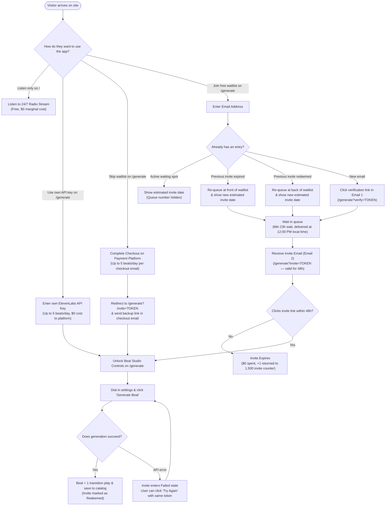
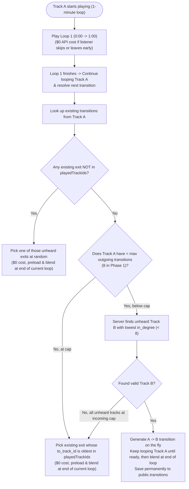

# Beat Generation, Queue Policy & On-the-Fly Transition Graph Architecture

Decision record: [ADR 0009](../decisions/0009-beat-generation-access-and-queue-policy.md).
Complements developer/agent guardrails in [ADR 0006](../decisions/0006-strict-ai-token-guardrails.md) and privacy/accessibility requirements in [ADR 0008](../decisions/0008-gdpr-and-wcag-accessibility-compliance.md).

---

## 0. Phased Rollout Overview

- **Phase 1 MVP (Radio Player + Waitlist Signup Only):**
  - Launches with **30–40 curated 1-minute infinitely loopable seed beats** (`/beat/0001`–`/beat/0040`).
  - AI transitions between tracks are generated lazily **on the fly** during continuous radio listening (after the first 1-minute loop completes), capped at **max 8 incoming and max 8 outgoing transitions per track**.
  - **`/generate` in Phase 1:** Collects email waitlist signups to notify users when public beat generation opens (no live beat generation or payments enabled yet).
- **Phase 2 (Full 4-Tier Public Generation on `/generate`):**
  - Opens waitlist invite dispatch, Paid Instant Pass, and BYOK studio controls on `/generate`, adding new community beats into the transition graph (e.g. capped at `k = 3` transitions per new beat).

---

## 1. User Funnel & 4-Tier Access Model (`/generate` in Phase 2)

All beat generation interactions happen on the unified **`/generate`** route, while passive listening happens on **`/`**.



### Plain-English UI Copy Baseline

Keep all baseline UI text literal and self-explanatory:

- **Remaining invite counter:** `"1,420 of 1,500 free invites remaining"` (with `aria-live="polite"`)
- **Waitlist status message:** `"Your invite is scheduled for Oct 26 around 12:00 PM."`
- **Paid instant option:** `"Skip the waitlist"`
- **BYOK option:** `"Use your own ElevenLabs API key"`

---

## 2. Waitlist Pacing, Estimated Date Math & Email Delivery

### 1,500-Invite Pool & Slot Return

- The free waitlist allocates **1,500 invites** per batch, paced at an average of **48 invites per day** (~1 invite every 30 minutes across a ~31-day window).
- Sending an invite (`status = 'invited'`) holds `1` slot from the counter.
- If an invite is not used within **48 hours**, a scheduled job marks it `status = 'expired'` and returns `+1` to the remaining invite counter so expired turns never waste the 1,500-beat allowance.
- When remaining invites reach `0`, the dispatcher pauses until the pool is manually replenished.

### Minimum 23-Hour Wait & 12:00 PM Local Time Delivery

1. **Why 23 hours minimum:** Even when the queue is empty, holding free invites for at least 23 hours keeps the instant pass meaningful and ensures anyone verifying their email before 1:00 PM local time still qualifies for the very next day's **12:00 PM (noon)** release window.
2. **Capturing timezone without friction:** On waitlist submission, the client reads `Intl.DateTimeFormat().resolvedOptions().timeZone` (e.g. `"Europe/Amsterdam"`, `"America/New_York"`, fallback `"UTC"`) and submits it with the form—requiring no extra form inputs and no IP geolocation lookups ([ADR 0008](../decisions/0008-gdpr-and-wcag-accessibility-compliance.md)).
3. **Estimated Invite Date Calculation (Queue Position Hidden):**
   - Let $N$ be the user's internal queue rank ($1$-indexed among verified `waiting` rows ordered by `is_priority_bump DESC, verified_at ASC`).
   - The number of days until their invite batch is:
     $$\text{days\_out} = \max\!\left(1,\; \left\lceil \frac{N}{48} \right\rceil\right)$$
   - The UI displays **only** the resulting target date at `12:00 PM` (never displaying `#N in line`, so an empty queue and a 40-person queue look identical).
   - Both re-entering the email on `/generate` and revisiting the verification link (`/generate?verify=TOKEN` from Email 1) display this live estimated date.

### Email Batching & Deliverability Safeguards

Because "12:00 PM local time" occurs once per hour across the world's 24 timezone bands, an **hourly cron job** dispatches invites for whichever timezone just reached 12:00 PM (up to the daily 48-invite budget):

- **Batch API:** Use the transactional email provider's batch endpoint rather than sequential single-email requests to avoid rate-limit (`429`) throttling when many users share a timezone (e.g. `America/New_York` or `Europe/Amsterdam`).
- **Idempotency Keys:** Pass a deterministic idempotency key (`invite-<waitlist_id>`) so retries never send duplicate emails.
- **Email Scanner Protection:** Corporate and webmail security scanners prefetch links via `GET`. Because opening `/generate?invite=TOKEN` only unlocks the UI and **does not** consume the invite (only a user-initiated `POST /api/generate` does), scanners cannot burn invites. Any "leave waitlist" action must require a `POST` confirmation or standard `List-Unsubscribe-Post` header.
- **Hard Bounce Recovery:** Provider bounce webhooks immediately transition hard-bounced rows to `expired` and return `+1` to the 1,500 invite pool.

---

## 3. Daily Cooldowns & Key Handling (5/Day Cap)

Both instant-generation paths enforce a maximum of **5 beats per 24-hour window**:

| Tier                      | Rate-Limit Identifier                                                | Storage & Privacy Policy                                                                                                                                                     |
| :------------------------ | :------------------------------------------------------------------- | :--------------------------------------------------------------------------------------------------------------------------------------------------------------------------- |
| **Tier C (Paid Pass)**    | Normalized checkout email (`HMAC-SHA256(SERVER_SECRET, email_norm)`) | Enforced per buyer email (never by IP address, avoiding false blocks on shared office/campus Wi-Fi, mobile CGNAT, or iCloud Private Relay).                                  |
| **Tier D (BYOK API Key)** | Hashed API key (`HMAC-SHA256(SERVER_SECRET, raw_api_key)`)           | Raw `ELEVENLABS_API_KEY` stays strictly in browser `sessionStorage` and is sent via `X-ElevenLabs-Api-Key` header. The server never writes the raw key to databases or logs. |

---

## 4. On-the-Fly Transition Graph & 1-Minute Loop Architecture

Tracks and transitions form a **directed graph** (`public.tracks` + `public.transitions`). This keeps AI generation costs capped while giving every listener a non-repeating stream of `/beat/####` tracks.

### 4-Digit `/beat/####` URLs & 1-Minute Loops

- Each beat gets the next 4-digit ID in creation order (`/beat/0001`, `/beat/0002`, …, `/beat/1500`, formatted with `String(beatNumber).padStart(4, "0")`).
- Visiting `/beats` on a cold request redirects to `/`; in-app header navigation links directly to the active beat (`/beat/####`).
- Every beat is **1 minute long and loops seamlessly** (`loop_start_ms` $\to$ `loop_end_ms`).

### Loading Beats: One at a Time

The browser never downloads the whole catalog.

- **Next beat:** `POST /api/beats/next` picks the next beat from the browser's play history ([ADR 0010](../decisions/0010-history-based-next-track-api.md)).
- **A specific beat:** `GET /api/beats?id=:id` returns one beat and its outgoing transitions, for cold loads and Back/Forward ([ADR 0013](../decisions/0013-url-as-source-of-truth-for-beat-routes.md)). The server reads only that track and its transitions.
- `GET /api/beats` without an `id` returns `400`. The full-catalog response is retired.
- `POST /api/beats/next` still reads the full catalog on the server to walk the graph. That is fine for the Phase 1 catalog (30–40 tracks) and is a known follow-up for larger catalogs.

### Browser Play History (`playedTrackIds`)

The browser stores a list of heard beat IDs in `localStorage`, ordered from oldest to newest:

```ts
const nextPlayedTrackIds = [
  ...playedTrackIds.filter((id) => id !== currentTrackId),
  currentTrackId,
];
```

When a beat plays, its ID moves to the end of the list. That way, if all transitions from the current beat have been heard before, the player can pick the one heard longest ago.

### How Radio Transitions Work (After Loop 1)

AI transitions only play during continuous radio listening, never when the user clicks Skip:



- **Degree Caps:**
  - **Phase 1 Seed Tracks (30–40 tracks):** Capped at **max 8 incoming and max 8 outgoing transitions** per track ($40 \times 8 \times \$0.07 = \$22.40$ hard ceiling).
  - **Phase 2 Community Tracks:** Configurable cap (e.g. **max 3–6 incoming/outgoing** per new track), automatically prioritized because brand-new tracks start at `in_degree = 0` and are chosen first by the _"lowest `in_degree`"_ rule.

### Manual Skip & Anonymous Skip Telemetry

- **Client-side skip transition (`$0` API cost):** If a listener clicks **Skip / Next**, the player does **not** generate or play an AI transition. Instead, it picks an unheard track and performs a client-side Web Audio transition.
- **Anonymous skip telemetry (`public.track_skip_events`):** Each skip records `{ track_id, skipped_at_sec, loop_count }` in Supabase with **zero IP addresses, User-Agents, cookies, or session/user IDs** ([ADR 0008](../decisions/0008-gdpr-and-wcag-accessibility-compliance.md)). Basic aggregate page traffic is measured cookielessly via **Vercel Web Analytics** (`@vercel/analytics`).

---

## 5. Supabase Schema Blueprint

To be added via a new migration in `supabase/migrations/` alongside [`20261022000000_create_audio_schema.sql`](../../supabase/migrations/20261022000000_create_audio_schema.sql):

```sql
-- 1. Sequence for 4-digit beat IDs (/beat/0001 .. /beat/1500+)
create sequence if not exists public.beat_number_seq start 1;

alter table public.tracks
  add column if not exists generation_tier text check (
    generation_tier in ('seed', 'waitlist', 'fastpass', 'byok')
  ) default 'seed';

-- Prevent duplicate directed transitions between the same pair of tracks
create unique index if not exists uniq_transition_pair
  on public.transitions (from_track_id, to_track_id);

-- 2. Anonymous track skip telemetry (zero PII / IP / session identifiers)
create table if not exists public.track_skip_events (
  id uuid primary key default gen_random_uuid(),
  track_id text not null references public.tracks(id) on delete cascade,
  skipped_at_sec numeric(6, 2) not null check (skipped_at_sec >= 0),
  loop_count integer not null check (loop_count >= 0),
  created_at timestamptz not null default now()
);

create index if not exists idx_track_skip_events_track
  on public.track_skip_events (track_id, created_at desc);

alter table public.track_skip_events enable row level security;

-- 3. Waitlist & invite tokens (RLS locked to service_role only)
create table if not exists public.beat_waitlist (
  id uuid primary key default gen_random_uuid(),
  email_raw text not null,
  email_normalized text not null,
  timezone text not null default 'UTC',

  -- Lifecycle: 'unverified' -> 'waiting' -> 'invited' -> 'redeeming' -> 'redeemed' | 'failed' | 'expired'
  status text not null check (
    status in ('unverified', 'waiting', 'invited', 'redeeming', 'redeemed', 'failed', 'expired')
  ) default 'unverified',

  is_priority_bump boolean not null default false,
  is_vip_fastpass boolean not null default false,
  payment_order_id text unique,

  verify_token text unique,
  claim_token text unique,
  last_error text,
  track_id text references public.tracks(id),

  verified_at timestamptz,
  invited_at timestamptz,
  expires_at timestamptz,
  redeemed_at timestamptz,
  created_at timestamptz not null default now()
);

-- Allow at most 1 active/in-progress entry per normalized email while keeping historical 'redeemed' rows
create unique index if not exists uniq_active_waitlist_email
  on public.beat_waitlist (email_normalized)
  where status in ('unverified', 'waiting', 'invited', 'redeeming', 'failed');

alter table public.beat_waitlist enable row level security;

-- 4. 5/day cooldown ledger (stores only HMAC-SHA256 hashes, never raw keys or emails)
create table if not exists public.generation_cooldowns (
  id uuid primary key default gen_random_uuid(),
  identifier_hash text not null,
  tier text not null check (tier in ('fastpass', 'byok')),
  created_at timestamptz not null default now()
);

create index if not exists idx_cooldown_lookup
  on public.generation_cooldowns (identifier_hash, tier, created_at desc);

alter table public.generation_cooldowns enable row level security;
```
