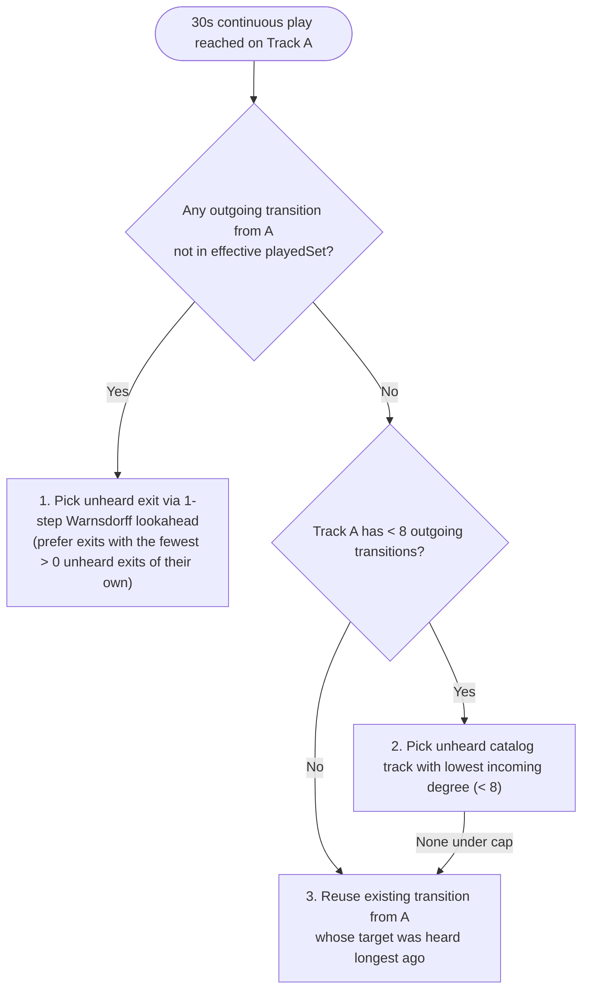

# Transition Graph & Rollout Architecture

Decision records: [ADR 0009](../decisions/0009-beat-generation-access-and-queue-policy.md), [ADR 0010](../decisions/0010-history-based-next-track-api.md), and [ADR 0013](../decisions/0013-url-as-source-of-truth-for-beat-routes.md).

---

## 1. Directed Transition Graph

Tracks (`public.tracks`) and transition bridges (`public.transitions`) form a **directed graph**. Every active track is ~1 minute long, loops seamlessly between `loop_start_ms` and `loop_end_ms`, and connects to up to **8 outgoing** and **8 incoming** transition bridges (`LIMITS.MAX_DEGREE_CAP = 8`).

### 2-Digit Beat Labels & URLs (`/beat/01`)

- Tracks resolve to a 2-digit label (`01`, `02`, …, `36`) via `deriveTrackLabel` in [`src/lib/tracks.ts`](../../src/lib/tracks.ts) and `formatBeatUrl` in [`src/lib/player/url.ts`](../../src/lib/player/url.ts).
- Individual beats live at `/beat/:slug` (e.g. `/beat/01`), which is the single source of truth for the active beat ([ADR 0013](../decisions/0013-url-as-source-of-truth-for-beat-routes.md)).

### On-Demand Beat Delivery

The browser never downloads the full catalog:

- **Next beat (`POST /api/beats/next`):** Accepts `{ currentTrackId, playedTrackIds, mode }` and resolves the next beat and transition bridge on the server ([`src/lib/player/graph.ts`](../../src/lib/player/graph.ts)).
- **Cold start (`GET /api/beats/next`):** Picks an initial beat from the tracks capable of the longest zero-repeat walk (`getZeroRepeatWalkCandidates` in [`src/lib/player/walk.ts`](../../src/lib/player/walk.ts)), persisted in `localStorage` (`beats_initial_beat`) until playback starts.
- **Specific beat (`GET /api/beats?id=:id`):** Fetches one beat and its outgoing transitions for direct `/beat/:slug` loads and browser Back/Forward history jumps.

---

## 2. Graph Traversal & Warnsdorff Lookahead

The browser stores heard track IDs in `localStorage` (`beats_played_ids`), ordered from oldest to newest:

```ts
export function updatePlayedTrackIds(
  playedTrackIds: string[],
  currentTrackId: string,
): string[] {
  return [
    ...playedTrackIds.filter((id) => id !== currentTrackId),
    currentTrackId,
  ];
}
```

### Auto-Advance (`mode: "auto"`)

After continuous playback reaches `AUTO_TRANSITION_RESOLVE_SECONDS` (default 30s), `selectNextGraphTrack` in [`src/lib/player/graph.ts`](../../src/lib/player/graph.ts) selects the next beat in three steps:



### Manual Skip (`mode: "skip"`) & History Traversal

- **Forward in history:** If the listener stepped back with **Previous**, clicking **Next** (or auto-advancing) replays the forward tracks in `playedHistory` in order before querying `/api/beats/next` at the tip (`resolveForwardBeatId` in [`src/lib/player/decisions.ts`](../../src/lib/player/decisions.ts)).
- **At the tip of history:** `resolveNextBeat` (`mode: "skip"`) returns `transition: null` (no transition bridge played). It still walks an unheard outgoing transition from `currentTrack` using Warnsdorff lookahead when available—so stepping back with **Previous** later still has a matching transition—or jumps to an unheard catalog track with open exits if all outgoing transitions from `currentTrack` were already heard.

### Sliding Cooldown Window (`REPEAT_COOLDOWN_WINDOW = 20`)

- While the listener has heard fewer than all active catalog tracks, every played track remains in the exclusion set so the player traverses the full crate with zero repeats.
- Once every active track appears in `playedTrackIds`, only the most recent **20 tracks** stay on cooldown (`playedTrackIds.slice(-20)`), reopening older tracks for continuous multi-session listening.

---

## 3. Planned Phase 2 Public Generation

Live ElevenLabs/Gemini beat and transition generation is disabled by default (`ALLOW_LIVE_AI_CALLS=false`, [ADR 0006](../decisions/0006-strict-ai-token-guardrails.md)). The planned Phase 2 rollout—covering the 1,500-invite waitlist pool, noon local-time batch dispatch, paid instant pass, and BYOK 5/day cooldown caps—is recorded in [ADR 0009](../decisions/0009-beat-generation-access-and-queue-policy.md).
