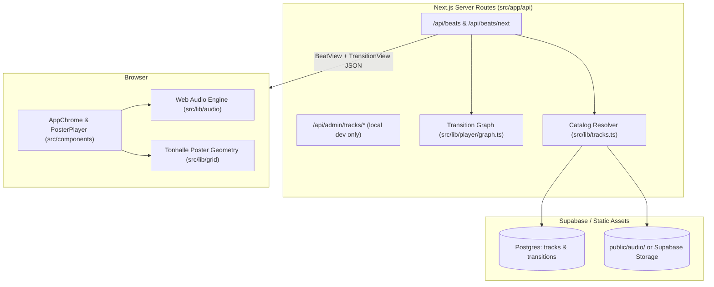
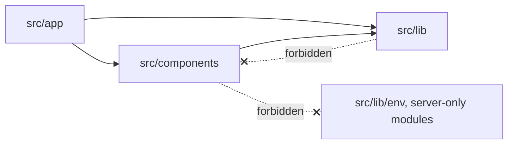

# Architecture overview

Beats for Days is a Next.js App Router web player backed by Supabase Postgres and audio storage. The client keeps a single persistent Swiss poster shell (`PosterPlayer`) mounted across all public routes while the Web Audio engine loops tracks and schedules 3-node transition splices.

## System



## Source layout

```text
src/
├── app/                 # Next.js routes, layouts, route handlers (entry points)
│   ├── about/           # /about editorial slot inside PosterPlayer
│   ├── admin/           # /admin local catalog dashboard + scoped Tailwind CSS (ADR 0016, 0019)
│   ├── api/             # Server endpoints: /api/beats, /api/beats/next, /api/admin/*
│   ├── beat/[slug]/     # /beat/:slug server-hydrated beat route
│   └── privacy/         # /privacy editorial slot inside PosterPlayer
├── components/          # React UI: thin, presentational (.tsx) + co-located .module.css
│   ├── admin/           # Local catalog table, upload form & transition audition modal
│   ├── audio/           # PosterPlayer, BeatNumber, PosterInfoSlot, TransportControls & context
│   ├── debug/           # Optional history & engine debug overlay (?debug=1)
│   ├── grid/            # VinylVisualizer, SpectrumBars & GridOverlay canvases
│   └── layout/          # AppChrome route wrapper (public poster vs /admin)
└── lib/                 # Framework-agnostic logic (.ts): unit & mutation tested
    ├── audio/           # AudioEngine, scheduler, 3-node splice coordinator, LRU cache, vinyl
    ├── grid/            # Tonhalle poster geometry, angular cuts, canvas drawing, GSAP morphs
    ├── player/          # Warnsdorff transition graph, zero-repeat walk, URL & history sync
    ├── types/           # Shared BeatView and AudioPlayerState contracts
    ├── admin.ts         # Server-only catalog CRUD & transition queries
    ├── tracks.ts        # Server-only BeatView queries & audio URL resolution
    └── env.ts           # Validated server env (server-only)
scripts/                 # Repo tooling: CRAP gate, audio converter, DB seed. Not shipped.
supabase/                # Local Supabase config & SQL migrations
test/                    # Shared Vitest setup & stubs
e2e/                     # Playwright + axe-core end-to-end browser tests (ADR 0012)
docs/                    # Architecture, ADRs & guides
```

Directories are created when first needed; don't add empty placeholders.

## Layering rules

Enforced by [`.dependency-cruiser.cjs`](../../.dependency-cruiser.cjs) via
`pnpm deps:check` (pre-push + CI).



| Rule                         | Why                                                             |
| ---------------------------- | --------------------------------------------------------------- |
| `lib-is-ui-agnostic`         | Keeps core logic testable in Node and reusable outside React    |
| `components-not-to-app`      | Routes compose components, never the reverse                    |
| `server-code-not-in-client`  | Secrets & server clients must never reach the browser bundle    |
| `app-code-not-to-tooling`    | `scripts/`, `test/`, and `e2e/` are not part of the shipped app |
| `stream-worker-is-isolated`  | Separate deployable; share code via an explicit package         |
| `no-circular`, `no-orphans`… | From `dependency-cruiser/configs/recommended-strict`            |

Server-only modules (`src/lib/env.ts`, `src/lib/supabase.ts`, `src/lib/tracks.ts`, `src/lib/admin.ts`) also `import "server-only"`, which makes Next.js fail the build if one is imported from a client component.

## Logic vs presentation

Logic (state machines, timing math, parsing, API mapping) goes in `.ts` modules
under `src/lib` or hooks. `.tsx` components wire that logic to the DOM.
Public components style themselves with co-located CSS Modules (`.module.css`) and OKLCH tokens from `src/app/globals.css`, all inlined into `<head>` via `experimental.inlineCss: true` ([ADR 0019](../decisions/0019-inline-semantic-css-and-isolate-admin-tailwind.md)).
See [ADR 0003](../decisions/0003-testing-strategy.md).

## Transition graph & playback routing

On-demand beat resolution (`POST /api/beats/next` and `GET /api/beats?id=:id`), Warnsdorff 1-step lookahead, and bidirectional `/beat/:slug` URL synchronization are detailed in [`generation-policy.md`](generation-policy.md), [ADR 0010](../decisions/0010-history-based-next-track-api.md), and [ADR 0013](../decisions/0013-url-as-source-of-truth-for-beat-routes.md).

## Audio asset delivery

Audio stems and transitions are delivered via [`src/lib/tracks.ts`](../../src/lib/tracks.ts) ([ADR 0011](../decisions/0011-local-static-audio-asset-delivery.md)):

- **Local development & tests (`USE_LOCAL_AUDIO=true` by default outside production):** Direct static asset serving from `public/audio/` (`/audio/...`) for zero-dependency offline playback.
- **Production (`USE_LOCAL_AUDIO=false` by default in production):** Resolves public URLs from the Supabase Storage `audio` bucket (`client.storage.from("audio").getPublicUrl(audioPath)`). The browser fetches raw bytes (`fetch() -> ArrayBuffer`) and decodes them into a Web Audio `AudioBuffer`.
- **Database contract:** The `tracks` and `transitions` tables store relative paths (`tracks/track-01.m4a`, `transitions/track-01-to-track-02.m4a`), seeded via `pnpm db:seed`.
- **Format:** AAC (`.m4a`) at 192 kbps with `+faststart` (generated via `pnpm audio:convert`), avoiding MP3 encoder delay and preserving sample-accurate loop points (`loopStartMs`, `loopEndMs`).
