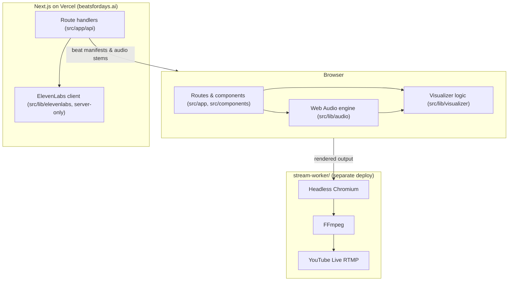
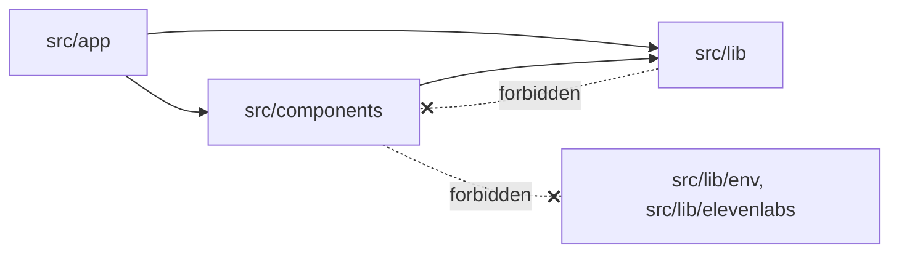

# Architecture overview

> Status: early. The app is scaffolded; the audio engine, generation pipeline
> and stream worker are not built yet. Update this doc as they land.

## System



## Source layout

```text
src/
├── app/                 # Next.js routes, layouts, route handlers (entry points)
│   └── api/             # Server endpoints: generation, inpainting
├── components/          # React UI: thin, presentational (.tsx)
│   ├── audio/           # Transport, volume, player controls
│   └── visualizer/      # Canvas / scene components
└── lib/                 # Framework-agnostic logic (.ts): unit & mutation tested
    ├── audio/           # AudioContext, buffers, sample-accurate scheduling
    ├── visualizer/      # Analyser → visual parameter mapping
    ├── elevenlabs/      # API client & inpainting helpers (server-only)
    ├── types/           # Shared types
    └── env.ts           # Validated server env (server-only)
scripts/                 # Repo tooling (e.g. CRAP gate). Not shipped.
test/                    # Shared test setup & stubs
e2e/                     # Playwright end-to-end browser tests (ADR 0012)
stream-worker/           # Headless streaming worker (separate deploy, isolated)
docs/                    # You are here
```

Directories are created when first needed; don't add empty placeholders.

## Layering rules

Enforced by [`.dependency-cruiser.cjs`](../../.dependency-cruiser.cjs) via
`pnpm deps:check` (pre-push + CI).



| Rule                         | Why                                                                 |
| ---------------------------- | ------------------------------------------------------------------- |
| `lib-is-ui-agnostic`         | Keeps core logic testable in Node and reusable by the stream worker |
| `components-not-to-app`      | Routes compose components, never the reverse                        |
| `server-code-not-in-client`  | Secrets & server clients must never reach the browser bundle        |
| `app-code-not-to-tooling`    | `scripts/`, `test/`, and `e2e/` are not part of the shipped app     |
| `stream-worker-is-isolated`  | Separate deployable; share code via an explicit package             |
| `no-circular`, `no-orphans`… | From `dependency-cruiser/configs/recommended-strict`                |

Server-only modules also `import "server-only"`, which makes Next.js fail the
build if one is imported from a client component.

## Logic vs presentation

Logic (state machines, timing math, parsing, API mapping) goes in `.ts` modules
under `src/lib` or hooks. `.tsx` components wire that logic to the DOM. This
keeps the important code fast to test and lets mutation testing focus on
`.ts` files. See [ADR 0003](../decisions/0003-testing-strategy.md).

## Beat generation & on-the-fly transition graph playback

Phased beat generation on `/generate` (Phase 1 waitlist signup; Phase 2 free
waitlist, paid instant pass, and BYOK) and the on-the-fly directed transition
graph playback model are detailed in
[`generation-policy.md`](generation-policy.md) and
[ADR 0009](../decisions/0009-beat-generation-access-and-queue-policy.md).

## Audio asset delivery

Audio stems and transitions are delivered via:

- **Local development:** Direct static asset serving from `public/audio/` (`/audio/...`) or streaming route handlers for zero-dependency offline playback ([ADR 0011](../decisions/0011-local-static-audio-asset-delivery.md)).
- **Production:** Supabase Storage CDN public bucket URLs.
- **Format:** AAC (`.m4a`) at 192 kbps with `+faststart` (generated via `pnpm audio:convert`), avoiding MP3 encoder delay and preserving sample-accurate loop points (`loopStartMs`, `loopEndMs`).
