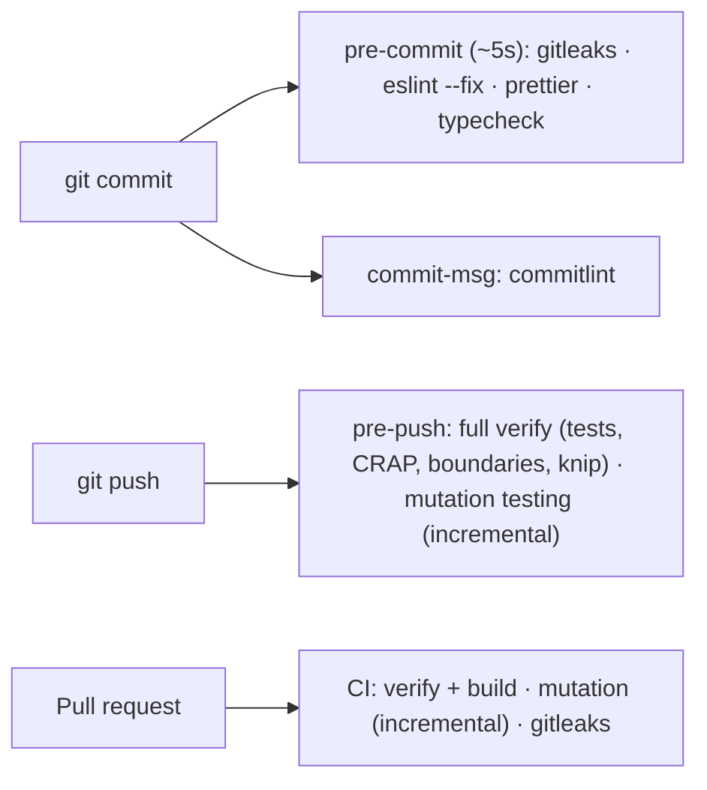

# Development workflow

## Setup

```bash
nvm use                 # Node from .nvmrc
pnpm install            # also installs git hooks (lefthook)
cp .env.example .env.local
brew install gitleaks   # optional: local secret scanning (CI always scans)
pnpm dev
```

## Inner loop

```bash
pnpm test:watch         # fast feedback while coding
pnpm verify             # full local gate before pushing / declaring done
pnpm test:mutation      # after logic-heavy changes
```

## What runs when



Hooks only touch staged files where possible. Emergency bypass:
`LEFTHOOK=0 git commit …` (CI still enforces everything).

## Commits

[Conventional Commits](https://www.conventionalcommits.org):
`type(scope): summary`. Types: `feat`, `fix`, `refactor`, `perf`, `test`,
`docs`, `build`, `ci`, `chore`. Example scopes: `audio`, `visualizer`,
`api`, `elevenlabs`, `stream`.

## CI

[`.github/workflows/ci.yml`](../../.github/workflows/ci.yml):

- **Quality gate**: typecheck, lint, format, boundaries, knip, tests + CRAP,
  build. Uploads coverage + `crap.json`.
- **Mutation testing**: Stryker incremental, baseline cached per branch
  (falls back to `main`). Uploads the HTML report.
- **Secret scan**: gitleaks over full history.

Recommended: protect `main` and require all three checks to pass.

## Reports (git-ignored)

| Path                           | Produced by          |
| ------------------------------ | -------------------- |
| `coverage/index.html`          | `pnpm test:coverage` |
| `reports/crap.json`            | `pnpm crap`          |
| `reports/mutation/index.html`  | `pnpm test:mutation` |
| `reports/dependency-graph.mmd` | `pnpm deps:graph`    |
