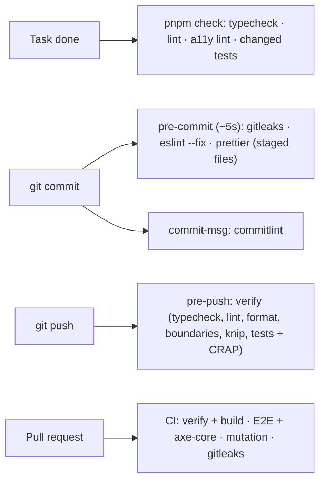

# Development workflow

## Setup

```bash
nvm use                           # Node from .nvmrc
pnpm install                      # also installs git hooks (lefthook)
cp .env.example .env.local
supabase start                    # local Supabase (requires Docker running)
pnpm db:seed                      # upload starter tracks & transitions
brew install gitleaks             # optional: local secret scanning (CI always scans)
pnpm dev
```

### Local Supabase Troubleshooting

- **Docker daemon not running:** Start Docker Desktop (`open -a Docker`) or OrbStack before running `supabase start`.
- **Stale container state (`no container found for project`):** Run `supabase stop --no-backup` followed by `supabase start` to recreate clean local containers.

## Inner loop

Run fast checks while you work. Leave the slow checks to the push hook and CI ([ADR 0017](../decisions/0017-staged-quality-gate.md)).

```bash
pnpm test:watch         # fast feedback while coding
pnpm check              # before calling a task done: typecheck · lint · a11y lint · tests for changed files
pnpm verify             # push gate (runs on git push): adds format · boundaries · knip · all tests + CRAP
pnpm verify:full        # same as CI: verify + E2E/axe-core + mutation testing
pnpm test:e2e           # on demand, when you change UI, routes or API flows
pnpm test:mutation      # on demand, or when CI reports surviving mutants
```

- `pnpm check` runs Vitest with `--changed`, so it only runs tests related to uncommitted files.
- E2E needs Docker and local Supabase. That is why it is not in a git hook.
- **Open a draft PR early.** CI only runs E2E and mutation testing on pull requests.

### Playback debug panel

The debug panel shows the active beat, route, history state and played ids. It needs two switches:

1. Set `DEBUG_PANEL=true` in the environment (`.env.local` locally, or the Vercel project settings).
2. Add `?debug=1` to the page URL.

- The env var is read at build time. On Vercel, changing it needs a redeploy.
- With the env var off, the panel's code never loads.
- With it on, visiting `?debug=1` enables the panel and sets a local cookie (`beats_debug_panel=1`), keeping the panel present across in-app and browser history navigation.
- The panel open/closed toggle state persists in `sessionStorage` (`beats_debug_panel_open`).
- The panel shows only the visitor's own local data. It sends nothing anywhere.

## Branching & PR workflow

1. **Branch naming:** Create feature/fix branches. Direct commits to `main` are blocked.
   - `feat/<feature-name>`
   - `fix/<bug-name>`
   - `refactor/<scope>`
   - `chore/<task>`
2. **Pull Requests:**
   - **Open a draft PR right after the first push.** CI is the only place E2E, axe-core and mutation testing run ([ADR 0017](../decisions/0017-staged-quality-gate.md)). A draft PR gives you that feedback while you keep working.

     ```bash
     git push -u origin HEAD                    # pre-push runs pnpm verify
     gh pr create --draft --fill --title "feat(audio): …"
     gh pr checks                               # see CI status
     gh run view --log-failed                   # read a failing job's log
     gh pr ready                                # when CI is green and the checklist is done
     ```

   - Agents follow the same steps (see `AGENTS.md`). They ask a human before marking a PR ready or merging.
   - PR title must follow Conventional Commits (e.g., `feat(audio): implement gapless bar looping`). Enforced in CI.
   - PR size target: ≤ 400 changed production lines (excluding tests, `docs/`, and lockfile). CI warns if exceeded.
   - Merge strategy: **Squash and merge** with conventional title to maintain linear history on `main`.
   - Head branch auto-deleted after merge.

## What runs when



Hooks only touch staged files where possible. Emergency bypass:
`LEFTHOOK=0 git commit …` (CI still enforces everything).

The agent Stop hook also runs typecheck and ESLint on changed files at the end of each agent turn ([ADR 0005](../decisions/0005-agent-guidelines.md)).

## Commits

[Conventional Commits](https://www.conventionalcommits.org):
`type(scope): summary`. Types: `feat`, `fix`, `refactor`, `perf`, `test`,
`docs`, `build`, `ci`, `chore`. Example scopes: `audio`, `visualizer`,
`api`, `elevenlabs`, `stream`.

## CI

[`.github/workflows/ci.yml`](../../.github/workflows/ci.yml):

- **Quality gate**: typecheck, lint, a11y lint, format, boundaries, knip,
  tests + CRAP, build, then E2E + axe-core against local Supabase. Uploads
  coverage, `crap.json` and the Playwright report.
- **Mutation testing**: Stryker incremental, baseline cached per branch
  (falls back to `main`). Uploads the HTML report.
- **Secret scan**: gitleaks over full history.

Recommended: protect `main` and require all three checks to pass.

## Reports (git-ignored)

| Path                            | Produced by          |
| ------------------------------- | -------------------- |
| `coverage/index.html`           | `pnpm test:coverage` |
| `reports/crap.json`             | `pnpm crap`          |
| `reports/mutation/index.html`   | `pnpm test:mutation` |
| `reports/playwright/index.html` | `pnpm test:e2e`      |
| `reports/a11y/report.html`      | `pnpm audit:a11y`    |
| `reports/dependency-graph.mmd`  | `pnpm deps:graph`    |
