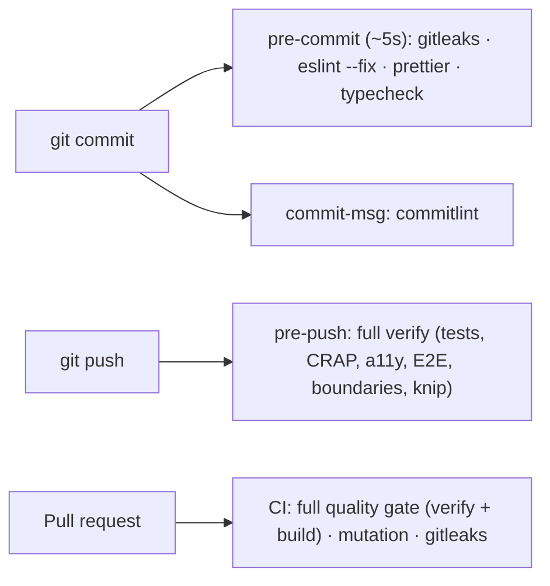

# Development workflow

## Setup

```bash
nvm use                           # Node from .nvmrc
pnpm install                      # also installs git hooks (lefthook)
cp .env.example .env.local
supabase start                    # local Supabase (requires Docker running)
pnpm exec tsx scripts/seed/cli.ts # upload starter tracks & transitions
brew install gitleaks             # optional: local secret scanning (CI always scans)
pnpm dev
```

### Local Supabase Troubleshooting

- **Docker daemon not running:** Start Docker Desktop (`open -a Docker`) or OrbStack before running `supabase start`.
- **Stale container state (`no container found for project`):** Run `supabase stop --no-backup` followed by `supabase start` to recreate clean local containers.

## Inner loop

```bash
pnpm test:watch         # fast feedback while coding
pnpm lint:a11y          # static OKLCH/hex contrast & semantic control lint
pnpm test:e2e           # end-to-end browser + axe-core + 320px reflow tests
pnpm verify             # full local gate before pushing / declaring done
pnpm test:mutation      # after logic-heavy changes
```

## Branching & PR workflow

1. **Branch naming:** Create feature/fix branches. Direct commits to `main` are blocked.
   - `feat/<feature-name>`
   - `fix/<bug-name>`
   - `refactor/<scope>`
   - `chore/<task>`
2. **Pull Requests:**
   - PR title must follow Conventional Commits (e.g., `feat(audio): implement gapless bar looping`). Enforced in CI.
   - PR size target: ≤ 400 changed production lines (excluding tests, `docs/`, and lockfile). CI warns if exceeded.
   - Merge strategy: **Squash and merge** with conventional title to maintain linear history on `main`.
   - Head branch auto-deleted after merge.

## What runs when



Hooks only touch staged files where possible. Emergency bypass:
`LEFTHOOK=0 git commit …` (CI still enforces everything).

## Commits

[Conventional Commits](https://www.conventionalcommits.org):
`type(scope): summary`. Types: `feat`, `fix`, `refactor`, `perf`, `test`,
`docs`, `build`, `ci`, `chore`. Example scopes: `audio`, `visualizer`,
`api`, `elevenlabs`, `stream`.

## CI

[`.github/workflows/ci.yml`](../../.github/workflows/ci.yml):

- **Quality gate**: typecheck, lint, format, boundaries, knip, tests + CRAP,
  build. Uploads coverage + `crap.json`.
- **Mutation testing**: Stryker incremental, baseline cached per branch
  (falls back to `main`). Uploads the HTML report.
- **Secret scan**: gitleaks over full history.

Recommended: protect `main` and require all three checks to pass.

## Reports (git-ignored)

| Path                            | Produced by          |
| ------------------------------- | -------------------- |
| `coverage/index.html`           | `pnpm test:coverage` |
| `reports/crap.json`             | `pnpm crap`          |
| `reports/mutation/index.html`   | `pnpm test:mutation` |
| `reports/playwright/index.html` | `pnpm test:e2e`      |
| `reports/a11y/report.html`      | `pnpm audit:a11y`    |
| `reports/dependency-graph.mmd`  | `pnpm deps:graph`    |
