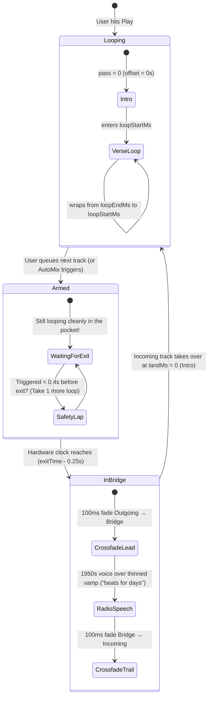

# Engineering Handoff: Audio Files, Gapless Looping & Frankenstein Transitions

This document explains the structure of the audio assets in `ui-starter-pack/`, how the metadata in `manifest.json` maps to each WAV file, and the exact Web Audio API scheduling math used to loop tracks seamlessly and transition between them without clicks, gaps, or drift.

---

## 1. Directory & Asset Overview

```
ui-starter-pack/
├── manifest.json              # Source-of-truth metadata for all tracks and transitions
├── HANDOFF.md                 # This engineering handoff document
├── README.md                  # Quick-start overview
├── tracks/
│   ├── track-a-soul-rhodes.wav     # 86 BPM · G minor · Rhodes Piano & Low Piano
│   ├── track-b-jazz-flute.wav      # 86 BPM · C Dorian · Jazz Flute & Vibraphone
│   └── track-c-soul-trumpet.wav    # 94 BPM · G minor · Muted Soul Trumpet & Tenor Sax
└── transitions/
    ├── track-a-to-track-b.wav      # A -> B (86 -> 86 BPM · same-BPM locked pocket)
    ├── track-b-to-track-a.wav      # B -> A (86 -> 86 BPM · same-BPM locked pocket)
    ├── track-a-to-track-c.wav      # A -> C (86 -> 94 BPM · cross-BPM radio handoff)
    ├── track-c-to-track-a.wav      # C -> A (94 -> 86 BPM · cross-BPM radio handoff)
    ├── track-b-to-track-c.wav      # B -> C (86 -> 94 BPM · cross-BPM radio handoff)
    └── track-c-to-track-b.wav      # C -> B (94 -> 86 BPM · cross-BPM radio handoff)
```

All audio files are **48,000 Hz, 16-bit Stereo PCM WAVs** (`sampleRateHz: 48000`, `numChannels: 2`).

---

## 2. Anatomy of a Beat File (`tracks/*.wav`)

Every beat in `tracks/` is generated as a full arrangement rather than a raw 4-bar clip. A single WAV file contains three distinct regions defined by `loopStartMs` (`entryMs`) and `loopEndMs` (`exitMs`):

```
0 ms                    loopStartMs (entryMs)                loopEndMs (exitMs)       durationMs
├──────────────────────────────┼──────────────────────────────────────┼───────────────────────┤
│   INTRO (& VERSE PICKUP)     │     MAIN LOOP: VERSE → CHORUS →      │   OUTRO               │
│   Plays once on entry        │              BRIDGE                  │   Only heard if loop  │
│                              │  ◄──────── Wraps gaplessly ───────── │   is disabled         │
└──────────────────────────────┴──────────────────────────────────────┴───────────────────────┘
```

### Track Coordinates Table

| Track Key | File                              | BPM | Key      | Intro (`0` → `loopStartMs`) | Loop Window (`loopStartMs` → `loopEndMs`) | Total Length |
| :-------- | :-------------------------------- | :-- | :------- | :-------------------------- | :---------------------------------------- | :----------- |
| **`A`**   | `tracks/track-a-soul-rhodes.wav`  | 86  | G minor  | `0.000s` → `8.372s`         | **`8.372s` → `50.233s`** (`41.861s`)      | `61.395s`    |
| **`B`**   | `tracks/track-b-jazz-flute.wav`   | 86  | C Dorian | `0.000s` → `16.743s`        | **`16.743s` → `55.814s`** (`39.071s`)     | `66.976s`    |
| **`C`**   | `tracks/track-c-soul-trumpet.wav` | 94  | G minor  | `0.000s` → `10.213s`        | **`10.213s` → `45.958s`** (`35.745s`)     | `51.064s`    |

### Why Solo Loops Don't Click

1. **Bar-Grid Snapping & Seam Alignment**: During generation, `loopStartMs` (the Verse downbeat) and `loopEndMs` (the end of the 4-bar Bridge) are snapped to transient onsets and bar boundaries.
2. **45ms Loop-Conditioned Tail**: The final `45ms` immediately preceding `loopEndMs` in each track WAV has been micro-conditioned against `loopStartMs` so that when `AudioBufferSourceNode` wraps from `loopEnd` back to `loopStart`, the waveform is phase-continuous.

---

## 3. How Gapless Single-Track Looping Works

We do **not** use `<audio>` HTML elements or JavaScript timers (`setTimeout` / `onended`) to re-trigger loops, as main-thread jitter causes audible gaps. Instead, we use the native Web Audio API `AudioBufferSourceNode` loop properties.

### Key Behavior of `AudioBufferSourceNode`

When you configure an `AudioBufferSourceNode` with:

```ts
const source = audioCtx.createBufferSource();
source.buffer = decodedTrackBuffer;
source.loop = true;
source.loopStart = track.loopStartMs / 1000; // entrySec
source.loopEnd = track.loopEndMs / 1000; // exitSec
source.start(when, 0); // Start at 0s (the Intro!)
```

- **Pass 0**: Web Audio begins playback at `offset = 0s` (playing the **Intro**), continues straight through `loopStart`, and plays the **Verse → Chorus → Bridge**.
- **Pass 1+**: The moment the hardware sample clock reaches `loopEnd` (the end of the Bridge), Web Audio jumps sample-accurately back to `loopStart` (the Verse downbeat). The Intro is never played again, and the Outro (`> loopEnd`) is never entered as long as `source.loop === true`.

### Computing the Visual Playhead in the UI

Because `AudioBufferSourceNode` does not expose a live `.currentTime` attribute, the UI calculates the playhead position on each `requestAnimationFrame` (or 50ms tick) from `audioCtx.currentTime`:

```ts
export function getPlayheadAndPass(
  audioCtxNow: number,
  segmentStartTime: number,
  initialOffsetSec: number,
  entrySec: number,
  exitSec: number,
  durationSec: number,
  isLooping: boolean,
): { positionSec: number; pass: number } {
  const rawElapsed =
    initialOffsetSec + Math.max(0, audioCtxNow - segmentStartTime);

  if (!isLooping) {
    return { positionSec: Math.min(rawElapsed, durationSec), pass: 0 };
  }

  // Still in the Intro or on the first pass through the loop body
  if (rawElapsed < exitSec) {
    return { positionSec: rawElapsed, pass: 0 };
  }

  // Wrapped at least once around [entrySec, exitSec]
  const loopLen = exitSec - entrySec;
  const wrappedOffset = (rawElapsed - exitSec) % loopLen;
  const pass = 1 + Math.floor((rawElapsed - exitSec) / loopLen);

  return {
    positionSec: entrySec + wrappedOffset,
    pass,
  };
}
```

---

## 4. Anatomy of a Transition Bridge (`transitions/*.wav`)

Each file in `transitions/` was generated by sending the outgoing track's 4-bar Bridge and the incoming track's Intro to ElevenLabs `music_v2_5` inpainting, then running cross-correlation alignment (`locate()`) against the local WAV files to find the exact sample boundaries.

In the **v12 Frankenstein Radio Transition** recipe:

- The outgoing Bridge groove continues into a thinned vamp (kick & bass hold the pocket while melody/snare lay out).
- A vintage 1940s/1950s radio broadcast voice speaks an original line containing _"beats for days"_.
- The music eases into the incoming track's Intro (`landMs: 0`).

### Structure Inside Each `transitions/*.wav` File

Every transition WAV file contains **three regions**:

```
0 ms               handleMs (250ms)                        handleMs + glueMs       bridgeDurationMs
├─────────────────────────┼─────────────────────────────────────────┼─────────────────────────┤
│   LEADING HANDLE        │              GLUE SECTION               │   TRAILING HANDLE       │
│   (250 ms)              │          (glueMs: ~6s – 11s)            │   (250 ms)              │
│   Matches outgoing      │   Thinned Bridge vamp + 1950s radio     │   Matches incoming      │
│   track's               │   voice ("beats for days")              │   track's               │
│   [exitMs - 250, exitMs]│                                         │   [landMs, landMs + 250]│
└─────────────────────────┴─────────────────────────────────────────┴─────────────────────────┘
 ▲                                                                   ▲
 │                                                                   │
 bridgeStart = exitTime - handleSec                                  nextStart = bridgeStart + handleSec + glueSec
 (100ms equal-power crossfade: Outgoing → Bridge)                    (100ms equal-power crossfade: Bridge → Incoming)
```

- **`handleMs` (`250 ms`)**: Audio kept on _both_ sides of the generated glue that duplicates the outgoing track before `exitMs` and the incoming track after `landMs`.
- **`crossfadeMs` (`100 ms`)**: Length of the equal-power crossfade performed at the start of each handle.
- **`glueMs`**: Exact measured duration (in ms) of the generated transition section between the two handles.
- **`landMs` (`0 ms`)**: The offset in the incoming track where handover occurs (`0 ms` means the incoming track starts at the beginning of its Intro).

### Why We Crossfade `250ms` _Before_ `exitMs`

Remember that the last `45ms` of the outgoing track before `exitMs` is loop-conditioned to wrap back to its own Verse. By starting the bridge at `exitTime - 250ms` (`handleMs = 250`) and completing a `100ms` (`crossfadeMs = 100`) equal-power crossfade, the outgoing track is **100% faded out at `exitTime - 150ms`**—well before reaching that `45ms` loop-conditioned seam! Meanwhile, because the first `250ms` of `bridge.wav` is the un-conditioned copy of that exact same `250ms` of music, the listener hears zero interruption.

---

## 5. The Queuing & Transition Lifecycle State Machine

A critical concept for the UI team is understanding **when** transitions happen and **how beats continue looping while a transition is queued**.

Transitions in this project are **quantized to musical structure**, not triggered abruptly on button-press.

### Why We Don't Cut Immediately

Boom bap grooves rely on pocket and structure. Cutting a beat in the middle of a verse or chorus sounds jarring. Instead:

1. The currently playing beat **keeps looping indefinitely** through its Verse → Chorus → Bridge.
2. When the user clicks "Transition to Beat B" (or an AutoMix timer triggers), the transition is **queued / armed**.
3. The current track **continues playing its regular groove** until it reaches the end of its Bridge (`exitSec`).
4. Only at that exact structural boundary does the handoff engage.



### The 4 Phases of Deck Status (`status.phase`)

| Phase                          | What the User Hears                                                            | UI Deck State & Indicators                                                                                                                                                                      |
| :----------------------------- | :----------------------------------------------------------------------------- | :---------------------------------------------------------------------------------------------------------------------------------------------------------------------------------------------- |
| **`track`** (Looping)          | Current track looping continuously: Verse → Chorus → Bridge → Verse.           | `status.phase = "track"`. Playhead moves within `[loopStartMs, loopEndMs]`. `pass` increments on each wrap.                                                                                     |
| **`pending`** (Armed / Queued) | Current track **still looping normally**. The user hears no change yet.        | `status.phase = "track"`, but `status.pending` is populated! Shows `pending.to` (next track) and `startsInSec` (countdown to the exit). The "Transition" button shows an armed / spinner state. |
| **`bridge`** (In Transition)   | Outgoing bridge fades into vintage voice over thinned vamp ("beats for days"). | `status.phase = "bridge"`. The outgoing playhead stays parked at `exitSec`. `bridgeElapsedSec` tracks progress through the glue.                                                                |
| **`track`** (New Track)        | Incoming track plays its Intro once, then locks into its own loop.             | `status.phase = "track"`. `current` becomes Track B. Playhead starts at `0s` (Intro) and enters its own loop window.                                                                            |

### The Lead Time Safety Window (`LEAD_SEC = 0.4s`)

What happens if the user clicks "Transition" 0.1 seconds before the Bridge ends?

- Scheduling Web Audio nodes in the past or under ~50ms causes clicks or dropped audio buffers.
- Therefore, the deck enforces `LEAD_SEC = 0.4s` (plus `handleSec = 0.25s`).
- If the upcoming exit is less than `0.65s` away from the current audio clock, the scheduler automatically increments the loop pass (`k++`).
- **Result:** The current beat smoothly loops through the Verse one more time and executes the transition on the subsequent exit. Playback remains 100% glitch-free.

---

## 6. Exact Scheduling Math for Track-to-Track Transitions

To transition seamlessly from **Track X** (currently playing) to **Track Y** via **Bridge X→Y**, schedule all three Web Audio nodes (`current`, `bridge`, `next`) on the `AudioContext` clock at least `400ms` (`LEAD_SEC = 0.4`) before `bridgeStart`.

### Step 1: Compute When Track X Next Reaches `exitSec`

For a looping track segment started at `segment.startTime` with initial buffer offset `segment.offset`:

```ts
/**
 * Returns the AudioContext timestamp (in seconds) when `segment` reaches `pointSec`
 * on loop pass `k` (k = 0 is the initial pass before any loop wrap).
 */
function getExitContextTime(
  segment: {
    startTime: number;
    offset: number;
    entrySec: number;
    exitSec: number;
  },
  k: number,
): number {
  const { startTime, offset, entrySec, exitSec } = segment;
  const loopLen = exitSec - entrySec;
  if (offset <= exitSec) {
    return startTime + (exitSec - offset) + k * loopLen;
  }
  return startTime + (exitSec - offset) + (exitSec - entrySec) + k * loopLen;
}
```

Find the smallest pass integer `k >= 0` such that:

```ts
const handleSec = bridge.timing.handleMs / 1000; // 0.25s
const crossfadeSec = bridge.timing.crossfadeMs / 1000; // 0.10s
const glueSec = bridge.timing.glueMs / 1000; // e.g. 7.2067s
const landSec = bridge.timing.landMs / 1000; // 0s

let k = currentPass;
while (
  getExitContextTime(currentSegment, k) - handleSec <
  audioCtx.currentTime + 0.4
) {
  k++;
}

const exitTime = getExitContextTime(currentSegment, k);
const bridgeStart = exitTime - handleSec;
const nextStart = bridgeStart + handleSec + glueSec;
```

### Step 2: Equal-Power Crossfade Curves

Use a 128-point sine/cosine equal-power curve so volume never dips during the `100ms` crossfades:

```ts
function equalPowerCurve(direction: "in" | "out"): Float32Array {
  const curve = new Float32Array(128);
  for (let i = 0; i < curve.length; i++) {
    const t = (i / (curve.length - 1)) * Math.PI * 0.5;
    curve[i] = direction === "in" ? Math.sin(t) : Math.cos(t);
  }
  return curve;
}
```

### Step 3: Schedule the Three Nodes on `AudioContext`

```ts
// 1. Fade out & stop the Outgoing Track at `bridgeStart`
currentSegment.gain.gain.setValueCurveAtTime(
  equalPowerCurve("out"),
  bridgeStart,
  crossfadeSec,
);
currentSegment.source.stop(bridgeStart + crossfadeSec + 0.02);

// 2. Start & fade in the Bridge at `bridgeStart`, then fade it out at `nextStart`
const bridgeSource = audioCtx.createBufferSource();
bridgeSource.buffer = decodedBridgeBuffer;

const bridgeGain = audioCtx.createGain();
bridgeGain.gain.setValueAtTime(0, audioCtx.currentTime);
bridgeGain.gain.setValueCurveAtTime(
  equalPowerCurve("in"),
  bridgeStart,
  crossfadeSec,
);
bridgeGain.gain.setValueCurveAtTime(
  equalPowerCurve("out"),
  nextStart,
  crossfadeSec,
);

bridgeSource.connect(bridgeGain).connect(masterGain);
bridgeSource.start(bridgeStart);
bridgeSource.stop(nextStart + crossfadeSec + 0.02);

// 3. Start & fade in the Incoming Track at `nextStart` (beginning at `landSec = 0`, its Intro)
const nextSource = audioCtx.createBufferSource();
nextSource.buffer = decodedNextTrackBuffer;
nextSource.loop = true;
nextSource.loopStart = nextTrack.loopStartMs / 1000;
nextSource.loopEnd = nextTrack.loopEndMs / 1000;

const nextGain = audioCtx.createGain();
nextGain.gain.setValueAtTime(0, audioCtx.currentTime);
nextGain.gain.setValueCurveAtTime(
  equalPowerCurve("in"),
  nextStart,
  crossfadeSec,
);

nextSource.connect(nextGain).connect(masterGain);
nextSource.start(nextStart, landSec);
```

---

## 7. Reference: `manifest.json` Schema

The `manifest.json` file at the root of `ui-starter-pack/` has the following structure:

```ts
interface StarterPackManifest {
  title: string;
  createdAt: string;
  tracks: Record<
    "A" | "B" | "C",
    {
      id: string; // "track-a" | "track-b" | "track-c"
      name: string; // Human-readable title
      runId: string; // Original generator run ID
      auditionId: number; // 1
      bpm: number; // 86 or 94
      key: string; // "G minor" | "C Dorian"
      genre: string; // "Soul" | "Jazz"
      leadInstrument: string;
      counterInstrument: string;
      fileName: string; // e.g. "track-a-soul-rhodes.wav"
      copiedFile: string; // Relative path: "tracks/track-a-soul-rhodes.wav"
      songId: string; // ElevenLabs song_id reference
      durationMs: number; // Full WAV duration in ms
      loopStartMs: number; // Loop entry point (Verse downbeat) in ms
      loopEndMs: number; // Loop exit/wrap point (end of Bridge) in ms
      loopDurationMs: number; // loopEndMs - loopStartMs
      sections: Array<{
        // Arrangement breakdown for UI timeline markers
        key: "intro" | "verse" | "chorus" | "bridge" | "outro";
        label: string;
        bars: number;
        duration_ms: number;
        positive_styles: string[];
        negative_styles: string[];
        direction_text: string;
      }>;
    }
  >;
  transitions: Array<{
    id: string; // e.g. "track-a-to-track-b"
    from: string; // "track-a"
    to: string; // "track-b"
    fromKey: "A" | "B" | "C";
    toKey: "A" | "B" | "C";
    bridgeKey: string; // Cache key in output/_transitions
    fileName: string; // e.g. "track-a-to-track-b.wav"
    copiedFile: string; // Relative path: "transitions/track-a-to-track-b.wav"
    timing: {
      handleMs: number; // 250
      crossfadeMs: number; // 100
      glueMs: number; // Measured glue duration in ms (e.g. 7206.7)
      landMs: number; // 0 (starts at incoming track's Intro)
    };
    recipeVersion: string; // "v12-frankenstein-intro-c4-gemini"
  }>;
}
```

---

## 8. Canonical Implementation References in This Repo

If the UI team wants to inspect or copy the existing React hooks directly, they live in:

- [`src/lib/useSeamlessLoopPlayer.ts`](../src/lib/useSeamlessLoopPlayer.ts) — Standalone single-track gapless Web Audio loop hook.
- [`src/lib/useTransitionDeck.ts`](../src/lib/useTransitionDeck.ts) — Full multi-track deck scheduler that manages `DeckGraph`, lookahead arming, equal-power crossfades, and playhead tracking across transitions.
- [`src/lib/transitions.ts`](../src/lib/transitions.ts) — Backend transition planner, ElevenLabs inpaint caller, and cross-correlation waveform aligner (`locate()`).
